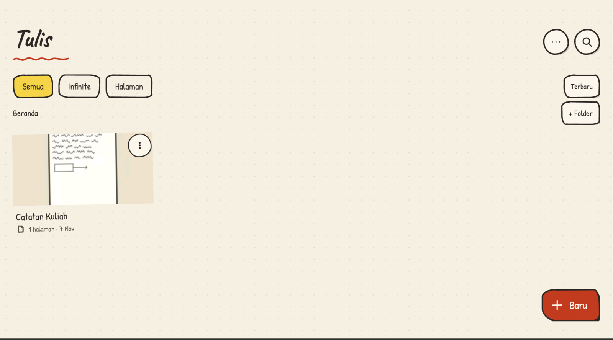
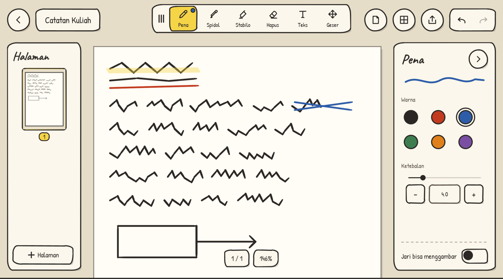

# Tulis

Aplikasi catatan tulisan tangan untuk Android, ringan dan sepenuhnya offline. Dibangun di atas [AndroidX Ink](https://developer.android.com/jetpack/androidx/releases/ink) dengan View biasa (tanpa Compose, AppCompat, atau Material).

<p align="center">
  
  
</p>

## Performa

Tulis dibuat untuk satu hal: menulis dengan tangan terasa cepat dan ringan.

| | |
|---|---|
| Ukuran APK rilis | 5,9 MiB |
| Start dingin | sekitar 0,65 detik (median 5 kali ukur, antara 0,59 dan 0,87 detik) |
| Izin | tidak ada |

Angka diukur pada build rilis di Xiaomi 25040RP0AG (`am start -W` setelah `force-stop`).

Yang membuatnya ringan:
- Menggambar goresan dengan mesin AndroidX Ink dan prediksi gerakan stylus (`MotionEventPredictor`) untuk menekan jeda tinta
- View biasa: tanpa Compose, AppCompat, atau Material
- Satu file biner per halaman, dimuat malas dan di luar thread UI; cache render halaman dan thumbnail LRU
- Ekspor PDF berupa vektor, bukan gambar
- Tanpa jaringan, tanpa analitik, tanpa layanan latar belakang

## Fitur

- Dua mode per notebook: kanvas tak hingga atau halaman bergulir vertikal (potret/lanskap) dengan peta mini
- Pena, spidol, stabilo, penghapus, urungkan/ulangi lintas halaman
- Gaya kertas: polos, bergaris, kotak-kotak, titik
- Folder bersarang dan tempat sampah
- Ekspor PDF (vektor) dan PNG
- Cadangan ke folder Obsidian vault lewat SAF: arsip `.tulis`, publikasi `.md` + PNG, pulihkan, dan penyelesaian konflik
- Tata letak ponsel dan tablet

## Unduh

APK bertanda tangan ada di halaman [Releases](https://github.com/Fadhil-Sabar/tulis/releases). Nilai SHA-256 tersedia di samping tiap APK. Android 8.0 (API 26) atau lebih baru.

## Privasi

- Tidak meminta izin apa pun, termasuk internet. Tidak ada analitik.
- Catatan disimpan di penyimpanan internal aplikasi. Folder vault hanya diakses bila Anda memilihnya.
- Auto Backup Android aktif: bila cadangan Google Anda hidup, folder catatan (tanpa tempat sampah) ikut tercadang.

## Build

Perlu JDK 17 dan Android SDK (`ANDROID_HOME`).

```
./gradlew assembleDebug testDebugUnitTest lintDebug
./gradlew installDebug
```

APK rilis bertanda tangan butuh `keystore.properties` lokal atau variabel lingkungan `KEYSTORE_FILE`, `KEYSTORE_PASSWORD`, `KEY_ALIAS`, `KEY_PASSWORD`. Tanpanya, `assembleRelease` menghasilkan APK tak bertanda tangan.

## Berkontribusi

Issue dan pull request dipersilakan. Baca [AGENTS.md](AGENTS.md) untuk struktur kode, jebakan yang diketahui, dan konvensi commit. Perubahan yang terlihat pengguna dicatat di [CHANGELOG.md](CHANGELOG.md). Laporkan kerentanan lewat fitur "Report a vulnerability" di tab Security repo ini.

## Lisensi

[Apache-2.0](LICENSE). Font Caveat dan Patrick Hand memakai SIL OFL 1.1, lihat [THIRD_PARTY_NOTICES.md](THIRD_PARTY_NOTICES.md).

## English summary

Tulis is a lightweight, fully offline handwriting notes app for Android built on AndroidX Ink with plain Views: a 5.9 MiB APK that cold-starts in about 0.65 s on the test tablet. It supports infinite-canvas and paged notebooks, nested folders, PDF/PNG export, and backup to an Obsidian vault via the Storage Access Framework. It requests no permissions. The UI is in Indonesian. Download signed APKs from [Releases](https://github.com/Fadhil-Sabar/tulis/releases); build with JDK 17 and `./gradlew assembleDebug`. Licensed under Apache-2.0.
